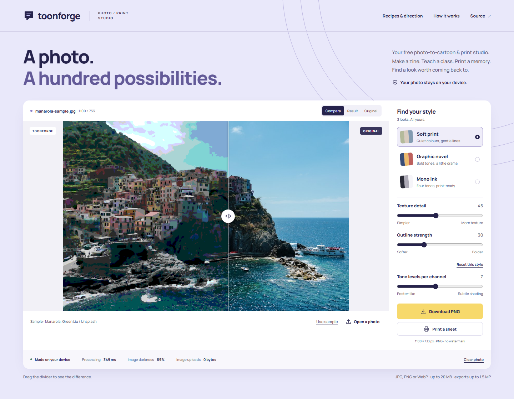
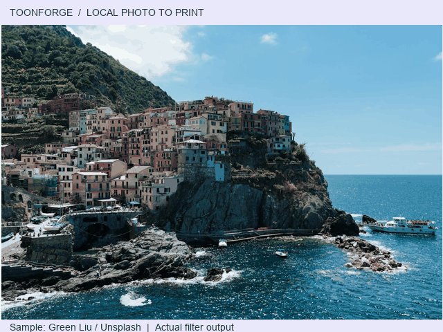
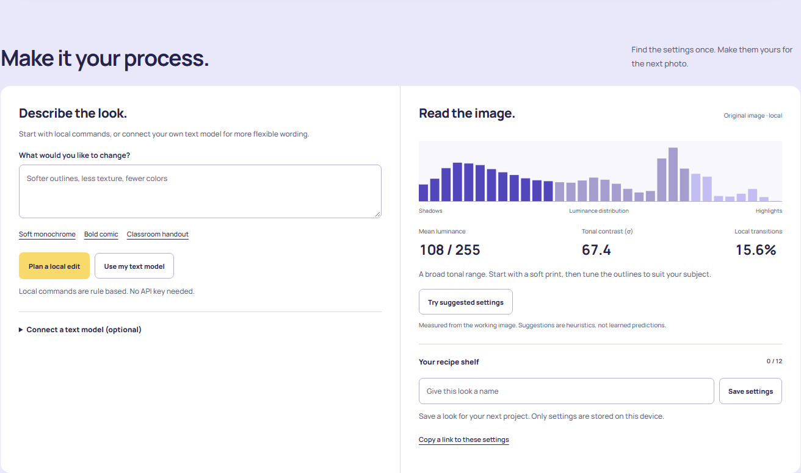
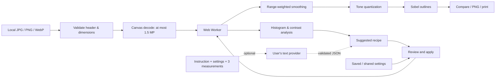

<div align="center">

# Toonforge

### Your photos. Your process. Your next print.

A free, private **photo-to-cartoon and print studio** for zines, classroom handouts and everyday artwork. Local computer vision does the pixel work. Optional text models help you direct it.

[**Open the studio →**](https://brej-29.github.io/toonforge-mobile-ai/) · [Guide](https://brej-29.github.io/toonforge-mobile-ai/guide.html) · [Portfolio handoff](HANDOFF.md) · [MCP tools](docs/MCP.md)

[](https://github.com/brej-29/toonforge-mobile-ai/actions/workflows/studio.yml)
[](LICENSE)


[](https://brej-29.github.io/toonforge-mobile-ai/)

</div>

## Make something worth coming back for

Open your photo, find a look, save its recipe, and use it again next week. There is no image-upload service, model download or mandatory account. A labeled sample lets you try the full workflow immediately.

| Your project | A useful starting point |
| --- | --- |
| Classroom handout or workshop | Simplify texture, soften outlines, inspect details, print a sheet |
| Zine or comic artwork | Try Graphic novel, reduce tone levels, compare edges, export PNG |
| A quiet memory print | Try Soft print or soft monochrome, preserve more shading |
| Repeatable visual style | Save named settings or share a settings-only link |
| Agent-assisted PNG processing | Connect local MCP to analyze and render files in a chosen folder |



*Actual filter output. Sample: Green Liu / Unsplash; [license](docs/SOURCES.md). A [static screenshot](docs/assets/studio.png) is available instead of animation.*

## An inspectable image engine

- **Three looks:** Soft print, Graphic novel and Mono ink; texture, outline and 3–12 tone-level controls.
- **Live comparison:** draggable wipe and explicit original/result views, PNG download and browser print sheets.
- **Image analysis:** alpha-weighted luminance histogram, tonal standard deviation and local transition density; explicit heuristics suggest settings.
- **Text direction:** free local command rules and an optional user-supplied text-model endpoint, key and model ID. Review plans before Apply.
- **Recipe shelf:** twelve named looks in local storage; shared links contain settings, never photos or keys.
- **Local MCP:** four tools share the production engine, with bounded PNG reads/writes and overwrite protection.
- **Practical UI:** responsive layouts, keyboard access, announcements, reduced motion, pauseable background motion and offline asset caching.



## Can a text-only model change an image?

**It can direct supported edits indirectly.** A text model turns an instruction into JSON settings. Toonforge validates the plan, shows it for review, and runs image filters locally after Apply. The model does not see the photo or produce pixels. Object removal, background replacement and generative reimagining require capabilities this release does not include.

For OmniRoute or another chat-completions-compatible router, enter your API base URL, model ID and key. The provider must allow browser CORS. One request sends your instruction, current settings and three numeric measurements. Output is capped at 220 tokens, with a 20-second timeout and no automatic retries. Keys stay in tab memory; provider billing and retention still apply. **No real paid key was used to verify this release**; provider boundaries are tested with mocked responses. [Setup and limits](https://brej-29.github.io/toonforge-mobile-ai/guide.html#text)



## What changed, and what is proven?

The original Flutter / FastAPI / Streamlit / Gradio project passed five API tests, but audited real requests returned **zero valid PNGs across two inference modes**: missing local weights and missing cloud configuration. Its successful test mocked output bytes. [Baseline evidence](docs/BASELINE.md)

The deployed path produces real decodable PNGs without inference infrastructure. The earlier stack is preserved under [legacy/](legacy/). The engine is tested against simpler alternatives.

| Synthetic measurement | Posterize | Box smoothing | Edge-aware |
| --- | ---: | ---: | ---: |
| Flat-region std, seeds 29 / 71 | 30.11 / 30.19 | 0 / 0 | 0 / 0 |
| Boundary contrast, seeds 29 / 71 | 116 / 117 | 63 / 63 | 127 / 127 |
| Thin-line contrast, seeds 29 / 71 | 44.33 / 42.67 | 0.67 / 2.00 | 23.33 / 23.33 |

The clean boundary contrast is 120: **127 is quantization overshoot**, not new detail. Low-contrast thin lines weaken. Two controlled targets establish neither artistic preference, printer savings nor product demand. Latest local engine-only timings are in [raw results](docs/evaluation-results.json), not an end-to-end phone benchmark. [Plan](docs/EVALUATION_PLAN.md) · [Negative findings](docs/EVALUATION.md)

This is **classical computer vision plus an optional language-model control layer**. No trained neural image model is included. [Portfolio claims and boundaries](HANDOFF.md)

## Run locally

Node.js 24 and npm. The image editor needs no credentials.

```sh
npm ci
npm run dev
```

```sh
npm test                 # engine, imports, analysis, recipes, provider boundaries, real MCP
npm run evaluate        # reproducible synthetic comparisons
npm run build           # type checks, both pages, versioned offline cache
npx playwright install chromium
npm run test:e2e         # real export/re-import, print, offline, workbench and AA checks
```

Use `npm.cmd` / `npx.cmd` on PowerShell if needed. Browser tests start a strict-port preview on `127.0.0.1:4399`; `LIVE_URL` can target an existing preview. `npm run smoke` requires a deployed HTTPS `LIVE_URL`.

For agents: `npm run mcp -- --root /absolute/path/to/images`. [MCP configuration and example calls](docs/MCP.md)

## Deployment, search and practical limits

**Public studio:** https://brej-29.github.io/toonforge-mobile-ai/

GitHub Actions checks the application before publishing `main` to Pages, then downloads and decodes a public PNG. [Workflow](.github/workflows/studio.yml) · [2.1 release evidence](docs/RELEASE_2_1.md)

Search support includes static content, a useful guide, canonical URLs, social previews, truthful application JSON-LD, a [sitemap](https://brej-29.github.io/toonforge-mobile-ai/sitemap.xml) and an optional [machine-readable index](https://brej-29.github.io/toonforge-mobile-ai/llms.txt). Ranking and AI recommendations are not guaranteed. Search Console verification/submission remains an owner follow-up. [SEO details](docs/SEO.md)

Browser input: JPG/PNG/WebP up to 20 MiB, 40 million source pixels and 20,000 pixels per side. Working output: **at most 1.5 MP**, no upscaling. MCP: PNG only, 4 MP / 8,192 pixels per side. These bounds suit small prints and web artwork, not large posters. Browser memory can still fail. Image darkness is a screen statistic, not printer consumption. Filtering does not anonymize people.

Photos live in tab memory and disappear on reload. Only recipe settings persist. Offline use needs completed first-visit caching; storage eviction may prevent it. Text calls need a connection. The host sees page traffic; the chosen provider sees explicitly requested text traffic. No analytics or photo server is included.

## Project notes

[**HANDOFF.md — product story, architecture, challenges, CV bullets, LinkedIn drafts and roadmap**](HANDOFF.md)

[Why](docs/WHY.md) · [Architecture](docs/architecture.md) · [Quality history](docs/QUALITY.md) · [2.1 checks](docs/RELEASE_2_1.md) · [Product](PRODUCT.md) · [Design](DESIGN.md) · [Sources](docs/SOURCES.md)

Code: [MIT](LICENSE). The bundled photo and its GIF/screenshot derivatives retain the [Unsplash License](https://unsplash.com/license). Manrope uses the SIL Open Font License, included in `public/FONT-LICENSE.txt`.