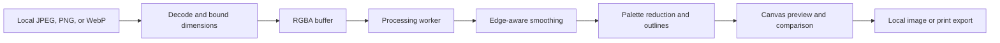

# Architecture

## 2.1 workbench and agent extension

The photo path below remains local. The worker now also computes a 32-bin alpha-weighted source luminance histogram, standard deviation and adjacent-pixel transition density. `src/workbench.ts` displays those measurements, applies explicit heuristic suggestions, and manages twelve validated recipes in local storage. `src/lib/recipes.ts` is shared across stored settings, hash links, local command plans, model replies and MCP settings.

The optional `src/lib/text-model.ts` connection sends a bounded instruction, current settings and three numeric aggregates directly to the visitor's selected compatible provider. It sends neither photo bytes nor filenames. Keys stay in form/tab memory. A plan is strict JSON with supported styles and bounded values, displayed for review before Apply; no code from the model is executed. Provider CORS, billing and retention apply. The free image workflow needs no connection.

`scripts/mcp-server.ts` runs separately in a local Node process using the official SDK. It exposes style listing, PNG analysis, local command planning and real PNG rendering using the same engine. Canonical path checks keep reads and output parents inside a supplied working root; exclusive file creation refuses overwrites. There is no remote MCP endpoint or server-side browser photo storage. See [MCP.md](MCP.md) and [HANDOFF.md](../HANDOFF.md).

The build emits two HTML entry points: the interactive studio and a JavaScript-independent guide. Both are linked and included in the public-asset cache. Search metadata and a sitemap describe the actual application; no ranking guarantee is inferred from their existence.

## Core photo path

The production application is a static TypeScript application built with Vite. The host serves the interface, code, fonts, and a labeled demonstration photo. User-selected photo bytes remain in browser memory; the core processing and export path needs no service credentials, model download, Python process, or remote inference endpoint.

The UI owns file validation, decoding, preview state, settings, accessibility, and export controls. The pure processing module owns deterministic pixel transforms and measurable image statistics; Node tests and browser workers call the same implementation. A worker keeps pixel loops away from input handling. Output from an obsolete settings request must never overwrite a newer result. A processing failure must surface an actionable error and leave the source available for retry.

## Why this stack

A server-backed model is the next best option when learned style transfer is essential. It brings model licensing, artifact validation, availability, quotas, and uploaded-photo handling into the critical path—the starting repository's exact failure surface. This product chooses inspectable simplification and stable source geometry. It cannot promise semantic drawing, generated detail, identity changes, or the aesthetics of a trained model.

Raw HTML/JavaScript could also implement this small application. TypeScript earns its place at RGBA/message/option boundaries, while Vite emits ordinary static files and gives production worker asset URLs. There is no database because no user account, durable gallery, or server-side photo storage is needed. Avoid adding a framework or service unless a measured workflow limitation requires one.

## Resource and privacy boundaries

Bound compressed input size and decoded dimensions before expensive transforms, then downsample to the supported working resolution. These are browser memory controls, not server upload limits. Browser image decoders may allocate memory before post-decode validation; extremely compressed images remain a documented limitation. Re-encoding through Canvas exports rendered pixels rather than copying camera metadata; the result is still identifiable image content and does not anonymize the subject.

Static hosting can still observe page/asset requests and ordinary connection information. A statement that photo bytes stay local does not mean the entire website has zero network traffic. Offline processing after assets are loaded and reliable offline reload are different capabilities; only claim the latter if the service-worker/cache tests establish it.

## Deployment and recovery

CI checks types, processing invariants, metric thresholds, static assets, and the main browser export flow. Default-branch deployment follows passing checks. A post-deployment browser smoke test uses the real public URL and decodes the downloaded PNG through re-import. The previous stack is archived under legacy and recoverable from backup tags; unfinished cloud/mobile modes are absent from the production UI.
